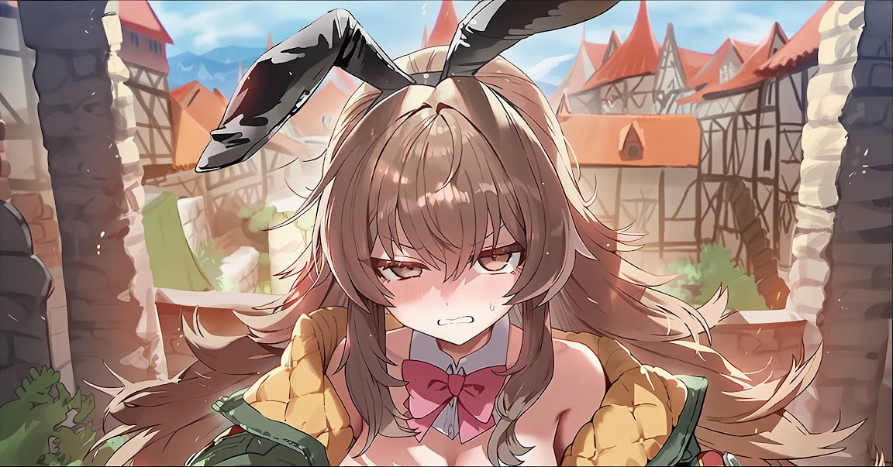

# Mythic Reverie — visual reference

**Every world. Every story. Every sound.**

A warm fantasy-inspired home for movies, television and music. The supplied image is the visual reference and the sign-in photograph; the original file is preserved unchanged.

| Role | Colour |
|---|---|
| Espresso background | #171210 |
| Parchment lettering | #F3E9D9 |
| Reverie Gold accent | #C6A16C |
| Burgundy rose accent | #A86973 |

The crescent, small star and play mark suggest a private world of stories and sound. The stacked serif wordmark keeps the name legible in navigation, sign-in and profile screens. Sign-in uses a framed photographic panel beside real form controls; phones show the photo above the form. The music player uses warm record textures and gold controls.

Primary assets: public/img/io-logo.svg (wordmark), public/img/io-icon.svg (icon), public/img/mythic-reverie-login.jpg (supplied reference). The legacy SVG filenames are retained for upgrade compatibility. No additional AI-generated character photos were substituted.
